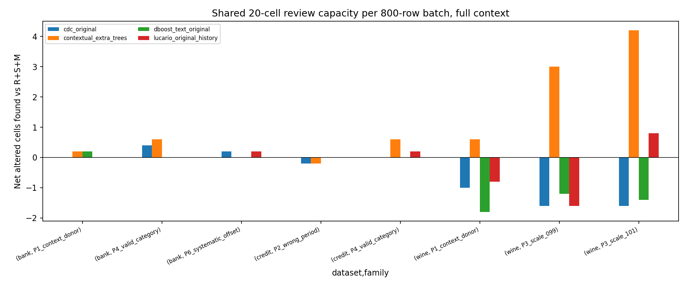

# Feature context, type inference and endpoints

Four target columns remain identical while inputs expand4→23Credit/20Bank/11Wine approved features. Outcome fields and original target snapshots are not leaked. `paired_context_budget.csv` contains matched full-minus-narrow effects for every family/mechanism/rate/seed. Full context does not produce a stable CDC review advantage: full RSM/equal-share/20 review means across families/mechanisms/rates span Bank−.2 to1.4, Credit−1.2 to.2, Wine−3.2 to0. These are within-source descriptive ranges, not independent-source uncertainty.

Native CDC's automatic dtype inference often treats numeric-valued ages/balances as categorical. We refit6 bounded diagnostics on the exact canonical histories/evaluation IDs, comparing native versus source-declared types. Closed endpoint tests are a separate sensitivity; native code's numeric outlier predicate uses <=lower OR >=upper, thus rejects exact interval endpoints.

| source | types | native_predicate_alerts | closed_interval_alerts | native_matches_primary |
| --- | --- | --- | --- | --- |
| credit | native_types | 695 | 695 | True |
| credit | declared_types | 190 | 187 | — |
| bank | native_types | 555 | 555 | True |
| bank | declared_types | 989 | 199 | — |
| wine | native_types | 921 | 921 | True |
| wine | declared_types | 157 | 155 | — |

Native-type untouched masks match primary saved masks exactly for all 3 sources. Native endpoints do not explain the primary huge burden here: the native695/555/921 totals are unchanged by closed endpoints. Under declared Bank types989 flags shrink to199 when endpoints are included;790 exact ties demonstrate why that diagnostic must distinguish dtype changes from endpoint changes. Source-declared Credit190→187 and Wine157→155. Declared types can expose, not automatically fix, endpoint behavior. Empty prediction sets/rare-history categories are counted by field; history remains uncertified clean.

All8 source-family ECAR5%seed101 cases run both type configurations (16 diagnostics) with saved masks and independently recomputed budget metrics. These are a bounded exploratory diagnostic, not a full new360case champion or replacement of archived native outputs.

An initial diagnostic incorrectly reloaded sources inside legacy pandas1.5, whose hash-based grouping differed from main pandas2.3. The source IDs then mismatched. Those attempts are preserved but excluded. A first suspected predictor-index mutation was withdrawn in `cdc_diagnostic_amendment.json`; the diagnosed cause is library-dependent re-splitting. The correction exports canonical main-runtime arrays/IDs via JSON; legacy fitting never re-splits. Original main720 cases always used the canonical producer and JSON transport and were unaffected. Independent masks now confirm exact native parity.

