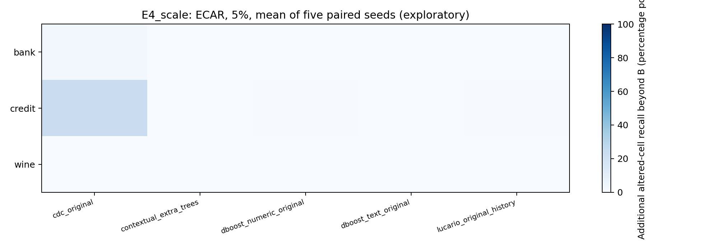
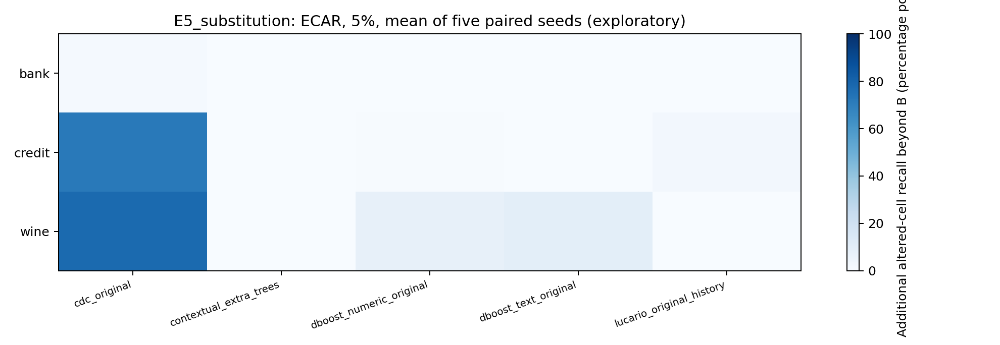
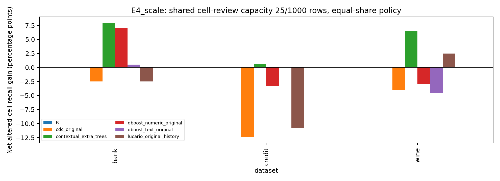
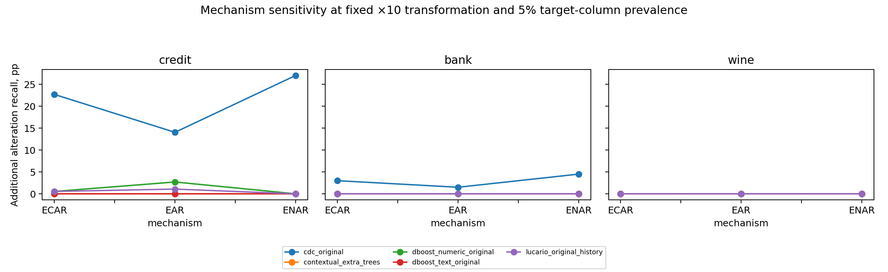

# Actual primary comparisons

**630 scenarios; 52,740 metric rows.** Raw machine-readable metrics: `results/thesis_pilot/all_metrics.csv.gz`; source/family/mechanism/rate/seed and applicability are retained. Prediction matrices are in `predictions/`; every scenario JSON pins their hash and the complete local injection log. No model ranking is inferred from unequal populations.

Operational E1/E2/E3: in all **360** applicable scenarios, both A and B have unconstrained recall 1.0 on the stipulated violations; additional verified hits beyond either complete control set are zero. These are functional ceiling/sanity results, not proof that all real data errors are covered.

A concrete A/B/detector/combination comparison (controlled changes, not semantic truth):

| Configuration, Credit substitution ECAR 5% | Mean recovered changed cells / 40 | Mean total cell alerts / batch |
| --- | --- | --- |
| A | 0.000 | 0.000 |
| B | 0.400 | 35.200 |
| CDC alone | 29.000 | 1143.200 |
| A + CDC | 29.000 | 1143.200 |
| B + CDC | 29.000 | 1159.400 |

The table below is **ECAR, 5% eligible target-column prevalence**, mean of five paired seeds. Hits concern controlled scale/substitution changes. Alerts are additional cell reviews per 800-row, four-target-column batch. Do not read these as natural semantic-error precision or production costs.

| Source | Family | Detector | Mean additional hits beyond B | Mean additional cell alerts | Added recall |
| --- | --- | --- | --- | --- | --- |
| bank | E4_scale | cdc_original | 1.200 | 919.800 | 0.030 |
| bank | E4_scale | contextual_extra_trees | 0.000 | 11.200 | 0.000 |
| bank | E4_scale | dboost_numeric_original | 0.000 | 16.000 | 0.000 |
| bank | E4_scale | dboost_text_original | 0.000 | 2.000 | 0.000 |
| bank | E4_scale | lucario_original_history | 0.000 | 16.000 | 0.000 |
| bank | E5_substitution | cdc_original | 0.600 | 917.000 | 0.015 |
| bank | E5_substitution | contextual_extra_trees | 0.000 | 11.200 | 0.000 |
| bank | E5_substitution | dboost_numeric_original | 0.000 | 16.000 | 0.000 |
| bank | E5_substitution | dboost_text_original | 0.000 | 2.000 | 0.000 |
| bank | E5_substitution | lucario_original_history | 0.000 | 16.000 | 0.000 |
| credit | E4_scale | cdc_original | 8.400 | 1126.400 | 0.227 |
| credit | E4_scale | contextual_extra_trees | 0.000 | 4.000 | 0.000 |
| credit | E4_scale | dboost_numeric_original | 0.200 | 18.000 | 0.005 |
| credit | E4_scale | dboost_text_original | 0.000 | 0.000 | 0.000 |
| credit | E4_scale | lucario_original_history | 0.200 | 70.400 | 0.005 |
| credit | E5_substitution | cdc_original | 28.600 | 1124.200 | 0.715 |
| credit | E5_substitution | contextual_extra_trees | 0.000 | 4.000 | 0.000 |
| credit | E5_substitution | dboost_numeric_original | 0.200 | 17.800 | 0.005 |
| credit | E5_substitution | dboost_text_original | 0.000 | 0.000 | 0.000 |
| credit | E5_substitution | lucario_original_history | 1.000 | 86.800 | 0.025 |
| wine | E4_scale | cdc_original | 0.000 | 1274.800 | 0.000 |
| wine | E4_scale | contextual_extra_trees | 0.000 | 2.000 | 0.000 |
| wine | E4_scale | dboost_numeric_original | 0.000 | 87.000 | 0.000 |
| wine | E4_scale | dboost_text_original | 0.000 | 114.200 | 0.000 |
| wine | E4_scale | lucario_original_history | 0.000 | 44.600 | 0.000 |
| wine | E5_substitution | cdc_original | 31.000 | 1346.400 | 0.775 |
| wine | E5_substitution | contextual_extra_trees | 0.000 | 2.000 | 0.000 |
| wine | E5_substitution | dboost_numeric_original | 3.200 | 91.000 | 0.080 |
| wine | E5_substitution | dboost_text_original | 4.000 | 119.200 | 0.100 |
| wine | E5_substitution | lucario_original_history | 0.000 | 59.000 | 0.000 |

Shared capacity: **25 cell reviews per 1,000 batch rows**, so 20 reviews for an 800-row batch. The following is the predeclared equal-share binary policy, net reviewed altered-cell hits relative to the same B capacity. Negative values are preserved. A method can alter which already-flagged B candidates get reviewed; budget gains are not necessarily new unconstrained detections.

| Source | Family | Detector | Net reviewed hits vs B | Lost B hits |
| --- | --- | --- | --- | --- |
| bank | E4_scale | B | 0.000 | 0.000 |
| bank | E4_scale | cdc_original | -1.000 | 1.000 |
| bank | E4_scale | contextual_extra_trees | 3.200 | 0.000 |
| bank | E4_scale | dboost_numeric_original | 2.800 | 0.000 |
| bank | E4_scale | dboost_text_original | 0.200 | 0.400 |
| bank | E4_scale | lucario_original_history | -1.000 | 1.000 |
| bank | E5_substitution | B | 0.000 | 0.000 |
| bank | E5_substitution | cdc_original | -0.600 | 0.600 |
| bank | E5_substitution | contextual_extra_trees | -0.200 | 0.600 |
| bank | E5_substitution | dboost_numeric_original | 0.200 | 0.400 |
| bank | E5_substitution | dboost_text_original | -0.600 | 0.600 |
| bank | E5_substitution | lucario_original_history | 0.600 | 0.400 |
| credit | E4_scale | B | 0.000 | 0.000 |
| credit | E4_scale | cdc_original | -4.600 | 4.600 |
| credit | E4_scale | contextual_extra_trees | 0.200 | 0.000 |
| credit | E4_scale | dboost_numeric_original | -1.200 | 1.200 |
| credit | E4_scale | dboost_text_original | 0.000 | 0.000 |
| credit | E4_scale | lucario_original_history | -4.000 | 4.000 |
| credit | E5_substitution | B | 0.000 | 0.000 |
| credit | E5_substitution | cdc_original | 0.000 | 0.000 |
| credit | E5_substitution | contextual_extra_trees | 0.000 | 0.000 |
| credit | E5_substitution | dboost_numeric_original | 0.000 | 0.000 |
| credit | E5_substitution | dboost_text_original | 0.000 | 0.000 |
| credit | E5_substitution | lucario_original_history | 0.000 | 0.000 |
| wine | E4_scale | B | 0.000 | 0.000 |
| wine | E4_scale | cdc_original | -1.600 | 1.600 |
| wine | E4_scale | contextual_extra_trees | 2.600 | 0.000 |
| wine | E4_scale | dboost_numeric_original | -1.200 | 1.200 |
| wine | E4_scale | dboost_text_original | -1.800 | 1.800 |
| wine | E4_scale | lucario_original_history | 1.000 | 0.000 |
| wine | E5_substitution | B | 0.000 | 0.000 |
| wine | E5_substitution | cdc_original | 0.000 | 0.000 |
| wine | E5_substitution | contextual_extra_trees | 0.000 | 0.000 |
| wine | E5_substitution | dboost_numeric_original | 0.400 | 0.000 |
| wine | E5_substitution | dboost_text_original | 0.000 | 0.000 |
| wine | E5_substitution | lucario_original_history | 0.000 | 0.000 |

Other percentages, mechanisms, baseline A and control-first policies are in `summary.csv`. `hard_priority_budget_summary.csv` repeats capacity evaluation with independently justified hard-contract priority; this post hoc policy sensitivity is not pooled into the predeclared result. Source/family strata remain distinct. Native numeric dBoost and CDC are absent where input domains are unsupported; missing execution is not zero performance.

Separate executed follow-ups: 18 all-feature probes, 18 source-type CDC probes and 45 Bank row-contract scenarios. The probes retain the same source splits and labels, are explicitly exploratory, and are not counted as independent new sources. The row experiment demonstrates a valid cross-field invariant: B detects each stipulated row violation; it never pretends to identify every wrong participant cell. See their JSON/NPZ outputs and the independent supplemental checks.
